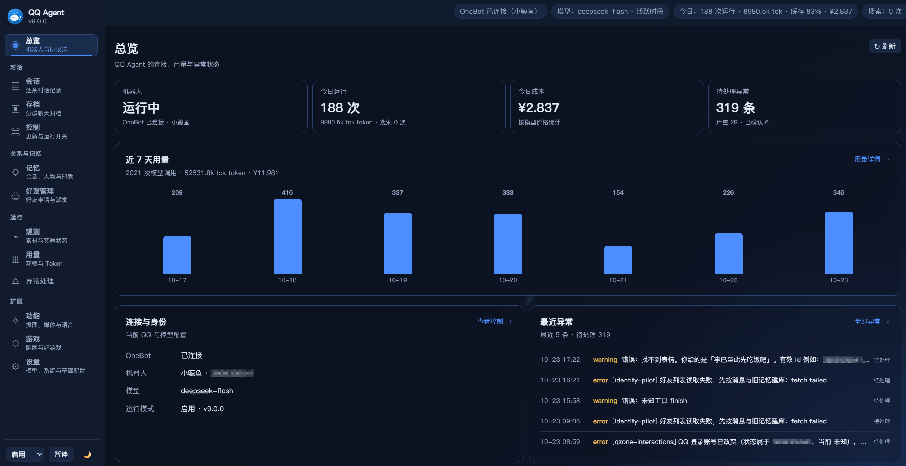

<div align="center">


# QQ Agent Plus

面向个人和小型群聊的 QQ 机器人：聊天与记忆、图片与账号检索、下载与 PDF、多人跑团、每晚用量汇报，以及可查看后台任务状态的网页控制台。

[](https://github.com/hjklggfh/qq-agent-plus/actions/workflows/ci.yml)
[](https://github.com/hjklggfh/qq-agent-plus/releases/latest)
[](LICENSE)
[](package.json)
[](docs/LINUX.md)
[](https://github.com/botuniverse/onebot-11)

[使用文档](docs/README.md) · [下载与更新](https://github.com/hjklggfh/qq-agent-plus/releases) · [问题反馈](https://github.com/hjklggfh/qq-agent-plus/issues) · [English（原版介绍）](README.en.md)



<p>v9.0.0 控制台总览；图中用量与异常为截图时的实例状态。</p>

</div>

本仓库是在 [QQ Agent Plus 原项目](https://github.com/sakurawwwxh/qq-agent-plus) 基础上持续维护的版本。通过外部 OneBot v11 协议端连接 QQ，兼容 OpenAI Chat Completions 模型服务，主要部署在 Linux 服务器，以 systemd 用户服务运行。

大模型负责聊天、叙事和需要推理的工具调用；明确指令、权限、下载任务、规则计算与存档由宿主程序处理。控制台使用原生 HTML / CSS / JavaScript 模块，无需前端构建。

## 现在可以做什么

| 功能 | 使用效果 | 详细说明 |
| --- | --- | --- |
| 群聊与私聊 | 自定义人设、分条回复、表情包、会话与人物记忆，支持群聊和私聊授权 | [人设](docs/PERSONAS.md) · [对话模式](docs/CONVERSATION_MODES.md) |
| 模型与用量 | 多供应商和兜底模型、调用预算、用量计价、上下文与省 Token 设置 | [模型价格](docs/model-prices.md) · [配置示例](docs/CONFIG-EXAMPLES.md) |
| 每晚汇报 | 按北京时间向管理员私聊汇报当日 Token、费用与主机状态；八类内容可选，支持只读预览 | [每晚汇报](docs/DAILY-REPORT.md) |
| 主动互动 | 群聊主动发言、持久化提醒、受限制的主动私信、每日动态与动态互动 | [主动私信](docs/PRIVATE_PROACTIVE.md) · [每日动态](docs/DAILY_MOMENTS.md) · [动态互动](docs/QZONE_INTERACTIONS.md) |
| 时间控制与小游戏 | 按上海时间配置全局／会话活跃时段；提醒、掷骰及可选的数字炸弹、谁是卧底等群游戏 | [配置示例](docs/CONFIG-EXAMPLES.md) · [稳定特性](docs/STABLE_FEATURES.md) |
| PID / Pixiv | 指定作品号或链接取图；多页合并卡片或打包 PDF；会话分级、任务记录、下载缓存，可选独立东京链路 | [PID 搜索](docs/PIXIV.md) · [可选东京链路](docs/PIXIV_TOKYO.md) |
| E-Hentai 检索 | 标签与关键词检索、每日榜单、每页 10 条、序号打包 PDF，宿主本地缓存定期清理 | [E站用法](docs/EHENTAI.md) |
| 以图搜图 | “找鸡”和默认“搜图”通过 SerpApi 查询 Google Lens；可指定 Google、Yandex、trace.moe 等平台，返回来源链接或匹配图片 | [用法与中转部署](docs/IMAGE-SEARCH.md) |
| X 账号检索 | 查询公开账号近期帖子，支持翻页、中文翻译与按结果编号取原图；官方 API 或独立东京浏览器中转需自行配置 | [X 账号检索](docs/X-SEARCH.md) |
| JM 下载 | 明确指令下载、图片处理、逐页合成 PDF、群聊／私聊文件发送、任务状态、日更与图库 | [JM 设置](docs/JM-SUOMINGOR.md) |
| B 站自动转发 | 识别链接、短链接与 QQ 分享卡片，获取信息并下载、发送视频 | [B 站转发](docs/BILIBILI-AUTO-FORWARD.md) |
| 多人跑团 | 独立工作台、世界观和角色卡导入、按世界建角与自由加点、叙事冒险、持久化战役 | [跑团用法](docs/TRPG.md) · [编写卡片](docs/TRPG-CARD-GUIDE.md) |
| 诡秘战术模式 | 多人各控制一角，方格战斗、移动、掩体与敌方回合；22 途径、序列 9—5 的简化成长规则 | [战术战役](docs/TRPG-TACTICAL.md) |
| 语音与图片能力 | 语音转写、视频音轨与画面理解，可选语音回复、图片生成；需要对应服务或本地依赖 | [配置示例](docs/CONFIG-EXAMPLES.md) |
| 功能与任务管理 | 16项功能集中搜索、筛选和进入设置；11项后台任务展示最近成功、失败原因和下次检查／调度时间 | [功能管理](docs/FEATURE-MANAGEMENT.md) |
| 网页管理与运维 | 配置、会话存档、用量、日志、备份、健康检查和 Release 更新；可选独立外部恢复巡检 | [Linux 手册](docs/LINUX.md) · [运维工具](docs/OPS.md) · [外部恢复](docs/RECOVERY.md) |

PID 搜索、JM、以图搜图都是宿主内置功能，有各自的设置入口，不需要去插件中心安装。新实例的这些功能及跑团默认关闭，配置后再启用。使用“找鸡”或默认“搜图”还需要配置 SerpApi Key、启用 SerpApi 平台并连接搜图中转。停用保留配置与存档，下载缓存按自身清理规则处理。

### 在网页里管理 Agent

- **总览与用量**：查看 QQ 连接、运行模式、调用次数、Token、今日成本和近期用量；费用按配置价格或估算口径显示，并非服务商账单。
- **功能 → 功能总览**：搜索功能、查看开关与后台状态，从卡片进入原设置页。后台“检查完成”表示调度检查正常结束，不代表消息已经发送；“发送成功”以功能确认记录为准。无记录会明确提示，进程内检查时间在重启后重新积累。
- **功能 → 每晚汇报**：配置全局管理员后启用，设置北京时间和发送内容，先预览再保存。默认23:00，新实例默认关闭；统计截至报告生成时，发送结果未知不会自动重发。

## 在 QQ 中怎么用

先在控制台开启对应功能，并授权目标群聊或私聊。下面是可直接使用的例子：

| 想做什么 | 发送内容 |
| --- | --- |
| 按作品号取图 | `PID 12345678`，或完整 Pixiv 作品链接 |
| 多页打包 PDF | `PID 12345678 PDF`；指定范围用 `PID 12345678 21-40 PDF` |
| 默认发送 PDF | 在「功能 → PID 搜索」选择默认发送方式；单次加“图片”可改回卡片 |
| 找账号／来源线索 | 回复当前会话已记录的图片发送“找鸡”；返回普通文字，含匹配类型、链接账号与来源网址 |
| 查图片来源 | 同一条消息发送“搜图”和图片，或回复当前会话已记录的图片发送“搜图”；返回原有结果列表，可选匹配图片卡片 |
| 指定搜图平台 | `搜图 SerpApi`、`搜图 Google`、`搜图 Yandex`、`搜图 trace.moe`；`搜图 全部`依次查已启用平台 |
| 查询 X 账号 | `X @用户名` 或 `X搜索 用户名`；`X下一页` 查看更早帖子 |
| 获取 X 帖子原图 | `X 6原图`，获取本次查询中第6帖的照片；先翻到第二页才有编号6 |
| 下载 JM | `JM1471930`，输出格式等在「功能 → JM 禁漫下载」配置 |
| 转发 B 站视频 | 在已启用会话发送 B 站链接或分享卡片 |
| 自定义世界跑团 | `/跑团 开团 世界ID` → 每人 `/跑团 建角` → 团主 `/跑团 开始` |
| 内置诡秘战役 | `/跑团 开团` → 每人 `/跑团 建角` → 团主 `/跑团 开始` |
| 查询／暂停战役 | `/跑团 状态`；团主发送“退出游戏”保存暂停，“继续跑团”恢复 |

“找鸡”和不指定平台的“搜图”都只调用 SerpApi，不自动回退到其他平台，也不消耗聊天模型 Token；SerpApi 搜图会消耗其账户查询额度，一张图最多进行三次 Lens 查询。明确的 PID、JM 下载指令也由程序处理，但自然语言选图、JM 标题翻译、跑团叙事等步骤仍可能调用模型。游戏进行中，在册玩家的普通消息作为跑团行动处理，优先于其他自动功能。

### 搜图功能如何复用

当前实现是宿主内置模块，加上独立的搜图中转服务，**不是可在其他 Agent 中直接安装的通用插件**。其他项目可以在保留 [MIT 许可](LICENSE) 和 [版权声明](NOTICE.md) 的前提下复用源码，但需要接入自己的图片获取、命令识别、权限控制和消息发送流程；现有中转接口也尚未作为跨项目稳定 API 发布。请勿把自己的 SerpApi Key、中转令牌或服务器配置写入公开仓库。每个部署者应自行配置凭据并承担相应的查询额度。实现与两端部署细节见 [以图搜图文档](docs/IMAGE-SEARCH.md)。

### 管理员私聊管理会话功能

在控制台设置“管理员 QQ”后，管理员与 Agent 私聊发送 `功能` 可查看指令。常用例子：

| 发送内容 | 作用 |
| --- | --- |
| `功能 列表` | 列出已配置权限的群聊和私聊 |
| `功能 查看 group:123456` | 查看该群的基础聊天与各功能授权状态 |
| `功能 查看 private:123456789` | 查看该私聊的授权状态 |
| `功能 开启 group:123456 海龟汤` | 授权指定群使用海龟汤 |
| `功能 关闭 group:123456 基础聊天` | 关闭该群的基础聊天准入 |
| `功能 关闭 group:123456 JM` | 覆盖原有 JM 群名单，禁止该群使用 JM |

支持“基础聊天、海龟汤、E站、跑团、JM”，群聊还支持“群游戏、群日报、群搜图”。`添加/删除`与`开启/关闭`同义。指令只接受管理员本人私聊，功能总开关仍在控制台；“已授权（全局关闭）”表示名单已配置，但功能尚未启用。部署此功能不会改动现有权限名单；只有明确的管理员修改指令才写入指定权限。JM 原有群名单文件保持不变，管理员修改使用独立覆盖项。

## 近期更新

[v9.0.0 正式版](https://github.com/hjklggfh/qq-agent-plus/releases/tag/v9.0.0) 已发布，主要更新：

- **每晚汇报**：当日 Token、总览口径费用与主机状态，八类内容可选并可预览。
- **功能总览**：统一功能目录、搜索、开关状态与设置入口。
- **后台任务观测**：统一生命周期管理，展示最近执行、检查完成／发送成功、历史失败及下次计划。
- **X 检索与体验改进**：公开账号近期帖子、翻页、翻译与原图获取；改进导航、外观和既有搜索功能。

升级保留配置与数据，启用条件及限制见 [v9.0.0 发布说明](docs/releases/v9.0.0.md)。历史更新见 [v8.1.3](docs/releases/v8.1.3.md)、[v8.1.2](docs/releases/v8.1.2.md) 和 [改动清单](docs/CHANGES.md)。

## 部署与首次使用

需要 Linux、可用的 systemd 用户服务，以及普通服务用户。已有 OneBot 协议端时可仅安装 Agent；全新机器也可使用全栈安装器。聊天需要自行配置兼容模型服务，API 费用由所用服务决定。

### 已有 OneBot，只安装 Agent

使用非 root 用户执行；部署脚本会检测 Node.js，必要时安装并校验独立 Node 22 运行时。

```bash
git clone https://github.com/hjklggfh/qq-agent-plus.git
cd qq-agent-plus
bash deploy.sh \
  --install-dir /mnt/data/qq-agent/app \
  --data-dir /mnt/data/qq-agent/data \
  --host 127.0.0.1 \
  --port 3210
```

在控制台填写 OneBot HTTP / 正向 WebSocket、模型和会话白名单。首次安装以观察模式启动；确认 QQ 已登录、配置正确，且旧机器人不会同时处理相同会话后再激活：

```bash
/mnt/data/qq-agent/app/manage.sh activate --confirm-exclusive
```

### 全新机器，一起安装协议端

```bash
git clone https://github.com/hjklggfh/qq-agent-plus.git
cd qq-agent-plus
bash deploy-all.sh
```

交互安装器部署 Docker / SnowLuma / OneBot 与 Agent，按提示完成配置和 QQ 扫码登录。它需要普通用户按需使用 sudo；OneBot 协议端属于独立软件。已有机器人环境请使用原部署流程更新，不要重新全栈安装。

仅部署 Agent 的上述示例只监听本机；**全栈安装器会配置对外监听的管理入口**，以安装输出为准。推荐通过 SSH 隧道访问，只对可信网络放行；不要把 noVNC、OneBot 直接开放到公网。完整步骤及依赖见 [Linux 部署手册](docs/LINUX.md)，宝塔／aaPanel 用户见 [面板部署](docs/BAOTA.md)。

### 打开网页控制台

Windows 下载本仓库后，双击根目录的 [console-tunnel.bat](console-tunnel.bat)，输入 `用户@服务器地址`；需要已有 SSH 登录方式，本机不需要安装 Node。

macOS / Linux 或已安装 Node 的本机也可执行：

```bash
SSHHOST=user@host node src/ops.js console --open
```

入口通过 SSH 转发控制台及 QQ 登录界面。进程由 systemd 用户服务管理，不要改用 PM2 或面板 Node 项目托管。

## 更新与数据

源码仓库、实际运行目录和数据目录是不同位置，例如：

```text
~/qq-agent-plus/               源码仓库：拉取 GitHub 更新
/mnt/data/qq-agent/app/        运行目录：含 manage.sh、.deployment.json
/mnt/data/qq-agent/data/       配置、聊天、记忆、功能状态及存档
/mnt/data/qq-agent/plugins/    外部插件目录
```

在源码仓库执行更新，然后部署到原位置；下面路径仅对应上文示例，已有安装必须沿用自己的目录及服务名。

```bash
git pull --ff-only origin main
bash deploy.sh \
  --install-dir /mnt/data/qq-agent/app \
  --data-dir /mnt/data/qq-agent/data
```

部署会校验现有 `.deployment.json` 的目标，保留数据与既有配置，并创建代码快照；关键参数不符会拒绝更新。`manage.sh` 必须在实际运行目录执行。不要用插件同步脚本更新宿主，也不要用源码覆盖数据目录。

如需跟随正式版本，可在控制台启用 Release 更新；确认仓库为 `hjklggfh/qq-agent-plus`。更新器只识别已发布的正式 Release，推送 main 不等于发布新版，详见 [升级与自动更新](docs/AUTO_UPDATE.md)。独立东京中转服务需按各自文档更新，升级 Agent 不会自动安装或更新它们。

PID 的图片／PDF 缓存默认定期清理；JM 下载文件、任务临时文件和 QQ 群文件有各自的保留设置，不能视为统一永久保存或统一自动删除。详见对应功能文档。

## 使用前了解这些限制

- **搜图受外部平台影响**：SerpApi Key 与额度由部署者自行提供；浏览器版 Google 可能要求验证码或同意确认，Yandex 也可能限流，东京出口不能保证免验证。匹配网页及链接账号不一定是原创出处；无原图结果时自动裁剪只提供相似图片线索，不确认人物身份。trace.moe 返回的是动画匹配帧与时间段。
- **PID 受图源、分级和网络影响**：默认只允许全年龄，未知分级按策略处理；PDF 可能压缩图片，不能保证无损原图。缺页或总页数未知时会标明“部分／完整性未确认”。Cookie 只在控制台填写，不要发到 QQ 或提交到仓库。
- **两个东京链路独立**：以图搜图和 PID 的代理、凭据、隧道与服务分别配置。PID 可沿用国内图片链路，JM 不因开启这两项功能而自动走东京。
- **会话权限各有语义**：跑团的独立白名单为空时禁止对应会话开团；JM 空群名单表示全部群开放，仍受宿主总体授权等限制。主动私信默认关闭、启用后默认演练，要求显式私聊白名单和既有会话。
- **战术模式是简化适配**：诡秘共 110 个序列能力节点，并非原著全部能力。普通世界自由加点保存实际属性值，不会自动生成新的战斗或技能规则。
- **QQ 文件发送需要路径可见**：协议端运行在 Docker 时，需把相关宿主数据目录挂载到容器相同绝对路径，避免上传找不到文件。
- **插件需要适配**：宿主只提供受限工具扩展接口，外部市场插件／skill 不能假定直接兼容。查看 [插件说明](docs/PLUGINS.md) 和 [开发接口](docs/PLUGIN-API.md)。

## 文档与开发

| 主题 | 入口 |
| --- | --- |
| 全部文档、功能设置与示例 | [文档索引](docs/README.md) |
| 部署、备份、服务状态、连接排查 | [Linux 手册](docs/LINUX.md) · [运维工具](docs/OPS.md) |
| 模型、语音、图片生成与其他配置 | [配置示例](docs/CONFIG-EXAMPLES.md) |
| 功能总览、后台状态与每晚汇报 | [功能管理](docs/FEATURE-MANAGEMENT.md) · [每晚汇报](docs/DAILY-REPORT.md) |
| 跑团卡片生成、导入与玩法 | [卡片指南](docs/TRPG-CARD-GUIDE.md) · [世界示例](docs/examples/trpg/narrative-world-with-creation.json) |
| 功能边界与历史变更 | [已知问题](docs/KNOWN-ISSUES.md) · [改动清单](docs/CHANGES.md) |

源码使用 Node.js ≥22.19 与原生 ES Module。安装开发依赖后可运行：

```bash
npm ci
npm run lint
npm run test:unit
npm run test:local
npm run test:prompt
npm run test:render
npm run test:scroll
npm run test:usage
```

发布工作流在 Linux 上执行语法、静态扫描、单元与本地回归、PDF 和前端检查，通过后才生成 Release 草稿。Windows 全量测试存在 Linux 脚本、文件句柄和信号等既有平台差异，不代表所有平台全量通过。

## 许可与来源

本项目使用 [MIT 许可](LICENSE)。感谢 QQ Agent、QQ Agent Plus 上游及其他贡献者，衍生关系与第三方版权见 [NOTICE](NOTICE.md)。OneBot 协议端及外部服务遵循各自许可与使用条款。
